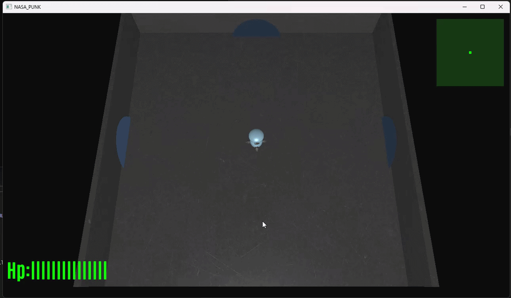

# 🤖 Droid Attack 

A real-time 3D top-down action shooter game built with modern C++ and OpenGL 3.3 (Core Profile).

<p align="center">
  
</p>

---

## 🎮 Project Overview

**Droid Attack** is a 3D sci-fi action shooter set inside a hostile space station. The player pilots a combat droid armed with a directional cannon, tasked with navigating through interconnected security chambers, defending against hostile drone waves, destroying stationary defense turrets, collecting power-ups, and defeating an armored boss before escaping through security portals.

---

## ✨ Key Features

- **Real-Time 3D Rendering with OpenGL 3.3 Core Profile**:
  - Custom GLSL shaders (Vertex and Fragment) for each visual entity.
  - Classic Phong illumination model (Ambient, Diffuse, and Specular components) with material shininess.
  - Normal and height mapping support for enhanced surface geometry.
  - Complex 3D polygonal model loading powered by **Assimp** and texture loading via **stb_image**.
- **3D Mouse Raycasting & Precision Aiming**:
  - Screen-to-world unprojecting system calculating the exact intersection of the mouse ray with the floor plane ($Y = 0$).
  - Continuous orientation of the player's chassis and cannon toward the 3D mouse cursor using trigonometric arc-tangent.
- **Interconnected Room & Portal System**:
  - Seamless transitions across multiple distinct game sectors (Hub, Turret Defense, Boss Arena, Drone Swarm).
- **Enemy Artificial Intelligence**:
  - Chasing drone AI with vector normalization and target tracking.
  - Stationary perimeter defense turrets with independent health pools.
  - Armored Boss encounter with multi-directional projectile attacks.
- **Weapon Mechanics & Power-Up System**:
  - Single-shot primary laser cannon with projectile lifecycle pooling.
  - Triple-shot spread Power-Up calculating directional spread angles via affine Y-axis rotation matrices.
- **User Interface (HUD) & Real-Time 2D Radar**:
  - In-game HUD featuring dynamic, color-coded health bars and power-up notifications.
  - High-definition dynamic typography rendered using **FreeType**.
  - Real-time 2D radar / minimap overlay mapping 3D world coordinates with alpha blending.
- **Multi-Track Audio Engine**:
  - Spatial 2D and 3D sound management powered by **irrKlang** (looping background soundtrack and responsive SFX).
- **Interactive State Machine & Menus**:
  - Interactive Main Menu (Start / Exit) and Game Over screens featuring mouse-driven button detection.

---

## 🕹️ Controls

| Key / Input | Action |
| :--- | :--- |
| <kbd>W</kbd> | Move Forward / Up |
| <kbd>S</kbd> | Move Backward / Down |
| <kbd>A</kbd> | Move Left |
| <kbd>D</kbd> | Move Right |
| **Mouse Cursor** | 3D Aiming / Orient robot toward target |
| **Left Mouse Button** | Fire laser cannon / Click menu buttons (`START`, `EXIT`, `Return to Menu`) |
| <kbd>ESC</kbd> | Exit game / Close application |

---

## 📁 Directory Structure

```text
OpenGLApp/
├── .gitignore                      # Excludes temporary build files (.vs, x64, .obj, .pdb, logs)
├── .gitattributes                 # Normalizes line endings and protects binary media
├── README.md                      # Project documentation (English)
├── OpenGLApp.sln                  # Visual Studio 2022 Solution
├── media/                         # Gameplay demonstrations and media previews
│   └── robot-ezgif.com-video-to-gif-converter.gif
├── glsl OpenGLApp/                # Auxiliary GLSL shader files
│   └── bullet_shader.fs           # Auxiliary bullet fragment shader
└── OpenGLApp/
    ├── OpenGLApp.vcxproj          # Visual Studio C++ project configuration
    ├── OpenGLApp.vcxproj.filters  # Logical filter structure for Visual Studio
    │
    ├── [ C++ Source & Header Modules ]
    ├── Main.cpp                   # Application entry point, GLFW/GLAD init, game loop
    ├── GameResources.h / .cpp     # Central resource manager (shaders, models, textures, fonts)
    ├── SceneRenderer.h / .cpp     # 3D scene rendering, room logic, mouse raycasting
    ├── HUDRenderer.h / .cpp       # 2D in-game HUD rendering (health bar, power-up indicators)
    ├── RadarRenderer.h / .cpp     # Real-time 2D radar / minimap rendering overlay
    ├── MenuRenderer.h / .cpp      # Main menu and Game Over screen rendering & UI logic
    ├── Player.h / .cpp            # Player movement, boundary checks, and shooting mechanics
    ├── Enemy.h / .cpp             # Chasing drone AI movement and direction logic
    ├── Physics.h / .cpp           # Optimized collision detection and geometry math
    ├── Input.h / .cpp             # GLFW input callbacks (keyboard, mouse position, clicks)
    ├── Globals.h / .cpp           # Global game variables, entities state, and score tracking
    ├── GameTypes.h                # Data structures (Bullet, Character, Vertex, Texture)
    │
    ├── [ Engine Core & Utilities ]
    ├── camera.h                   # Euler-angle camera (yaw, pitch, zoom, view matrix)
    ├── mesh.h                     # Mesh abstraction with VAO, VBO, EBO, and Draw routines
    ├── model.h                    # 3D model importer and mesh extractor using Assimp
    ├── shader.h                   # GLSL shader compiler, linker, and uniform setters
    ├── stb_image.h / .cpp         # Image loading library for textures
    ├── glad.c                     # GLAD OpenGL 3.3 Core function pointer loader
    │
    ├── [ GLSL Shader Pipeline (Vertex & Fragment) ]
    ├── shader.vs / .fs            # Player robot shader with Phong lighting
    ├── room_shader.vs / .fs       # Room architecture shader with ambient/diffuse lighting
    ├── enemy_shader.vs / .fs      # Drone enemy shader
    ├── cannon_shader.vs / .fs     # Defense turret and cannon shader
    ├── bullet_shader.vs / .fs     # Laser projectile shader
    ├── porta_shader.vs / .fs      # Security portal / transition gateway shader
    ├── gem_shader.vs / .fs        # Collectible gem shader
    ├── puddle_shader.vs / .fs     # Environmental hazard / puddle shader
    ├── radarShader.vs / .fs       # 2D radar disk and entity blip shader
    ├── text_shader.vs / .fs       # Dynamic TrueType font rendering shader
    ├── menuShader.vs / menuShaderF.fs # Interactive 2D menu quad shader
    ├── light_cube.vs / .fs        # Light source debugging visualization shader
    │
    ├── [ Game Assets & Media - resources/ ]
    ├── resources/robot/           # Player 3D model (.obj/.mtl) and PBR textures
    ├── resources/enemy/           # Enemy drone 3D model and textures
    ├── resources/cannone/         # Stationary defense turret 3D model
    ├── resources/bullet/          # Laser projectile 3D model and textures
    ├── resources/portale/         # Security portal 3D model and textures
    ├── resources/STANZA/          # Room 3D architectural models
    ├── resources/gem/             # Collectible gem 3D models
    ├── resources/Puddle/          # Floor puddle 3D model
    ├── resources/fonts/           # Vector TrueType fonts (Antonio, Roboto)
    ├── resources/media/           # Audio assets (.wav, .mp3, .s3m, .xm)
    ├── resources/menu/            # Menu background and button artwork
    └── resources/images/          # UI textures and Game Over backdrops
    │
    └── [ Demo & Test Modules - demos/ ]
        ├── Loader/                # Model and texture loader test harness
        ├── Simple_Game/           # Early game prototype
        ├── Sounds/                # Audio engine integration tests
        └── Text_Rendering/        # FreeType font glyph rasterization test harness
```

---

## 🧠 Implementation Details

### 1. Graphics Pipeline & Custom GLSL Shaders
- **Phong Reflection Model**:  
  All primary 3D entities (player, enemies, rooms, portals) are rendered using specialized shaders implementing the classic Phong illumination model:
  $$\vec{I} = \vec{I}_{\text{ambient}} + \vec{I}_{\text{diffuse}} + \vec{I}_{\text{specular}}$$
  Uniform variables configure light properties (`light.position`, `light.ambient`, `light.diffuse`, `light.specular`) and surface parameters (`material.shininess`), producing realistic reflections and depth across all station rooms.
- **Hierarchical Asset Loading via Assimp (`model.h`, `mesh.h`)**:  
  Wavefront `.obj` models along with their accompanying `.mtl` material files are imported using Assimp. The engine parses node hierarchies into discrete `Mesh` structures, extracting vertex coordinates, normal vectors, texture coordinates (UVs), and tangent/bitangent vectors directly into dedicated OpenGL buffers (`VAO`, `VBO`, `EBO`).

### 2. 3D Mouse Raycasting & Aiming Mathematics
In order to achieve natural top-down aiming, the engine performs a mathematical **Viewport-to-World Raycast**:
1. Mouse cursor screen coordinates are obtained and adjusted for OpenGL's bottom-left origin (`SCR_HEIGHT - lastY`).
2. Two 3D coordinates are calculated in world space via `glm::unProject`: one on the *Near Plane* ($Z = 0.0$) and one on the *Far Plane* ($Z = 1.0$), using the current view (`view`) and perspective projection (`projection`) matrices.
3. The normalized ray direction is computed:
   $$\vec{r}_{\text{dir}} = \frac{\vec{P}_{\text{far}} - \vec{P}_{\text{near}}}{\|\vec{P}_{\text{far}} - \vec{P}_{\text{near}}\|}$$
4. The exact 3D target point on the floor plane ($Y = 0$) is found by analytical intersection:
   $$t = -\frac{\vec{P}_{\text{near}}.y}{\vec{r}_{\text{dir}}.y} \implies \vec{P}_{\text{target}} = \vec{P}_{\text{near}} + \vec{r}_{\text{dir}} \cdot t$$
5. The player's rotation angle is evaluated frame-by-frame via two-argument arc-tangent:
   $$\theta = \operatorname{atan2}(\vec{d}_x, \vec{d}_z)$$
   aligning the robot's heading and weapon barrel with the 3D mouse position.

### 3. Finite State Machine (FSM) & Game Loop
The application lifecycle in `Main.cpp` is governed by a finite state machine with delta-time integration (`deltaTime = currentFrame - lastFrame`):
- **State `0` (Main Menu)**: Renders the 2D title menu and tests mouse click bounding boxes against the `START` and `EXIT` buttons.
- **State `1` (Active Gameplay)**: Updates entity physics, executes enemy AI, processes ballistics, and renders the 3D scene, HUD, and radar.
- **State `-1` (Game Over)**: Displays the defeat screen with game statistics and a button to reset health points, scores, and entity states back to the Main Menu.

### 4. Multi-Room Map System & Portal Transitions
The space station is structured into five distinct sectors:
- **Room 0 (Central Hub)**: The starting staging area featuring portals leading into surrounding station sectors.
- **Room 1 (Turret Sector)**: A corridor defended by 4 stationary perimeter defense cannons with individual health meters.
- **Room 2 (Boss Arena)**: The final confrontation chamber featuring a high-durability Boss entity with rapid, multi-directional weapon fire.
- **Room 3 (Perimeter Battery)**: A high-intensity combat room guarded by 6 rapid-fire ceiling/wall defense turrets.
- **Room 4 (Drone Swarm Sector)**: An open arena containing a swarm of 3 mobile chaser drones driven by active pursuit AI.
- **Portal Mechanics**: Room transitions are triggered via proximity testing (`hitbox`). When the player reaches an active exit coordinate, `roomActive` is updated, and the player is translated to the corresponding entrance coordinate of the target room.

### 5. Enemy Artificial Intelligence (Vector Chasing AI)
Mobile drones track and pursue the player continuously (`enemyChasing` in `Enemy.cpp`):
1. Compute the delta displacement vector between the player and drone:
   $$\vec{v} = \vec{P}_{\text{player}} - \vec{P}_{\text{enemy}}$$
2. Normalize the vector to maintain constant movement speed:
   $$\hat{v} = \frac{\vec{v}}{\|\vec{v}\|}$$
3. Increment the drone position along the direction vector:
   $$\vec{P}_{\text{enemy}} \mathrel{+}= \hat{v} \cdot v_{\text{enemy}} \cdot \Delta t$$
4. Align the drone's orientation dynamically toward the player using $\operatorname{atan2}(\Delta x, \Delta z)$.

### 6. Physics, Collision Detection & Ballistics
- **Squared Distance Hitbox Optimization (`Physics.cpp`)**:  
  All entity collisions (player vs. portals, bullets vs. enemies, enemies vs. player) are calculated using 2D circular/cylindrical hitboxes on the $XZ$ plane. To avoid the computational cost of square root operations, collisions are evaluated using squared distances:
  $$(\Delta x)^2 + (\Delta z)^2 \le (r_1 + r_2)^2$$
- **Projectile Lifecycle & Pooling**:  
  Bullets are managed within a dynamic array (`bullets`). Active projectiles travel along their initial direction vector. If a projectile exits the room bounds (`roomSize`), it is automatically deactivated and recycled for future shots.
- **Multi-Shot Spread Power-Up**:  
  When the Multi-Shot upgrade is active, firing triggers a 3-bullet spread: one central projectile along $\vec{d}$ and two lateral projectiles angled at $\pm 22^\circ$ computed via affine Y-axis rotation matrices (`rotateY`):
  $$\vec{d}_{\text{spread}} = R_Y(\pm 22^\circ) \cdot \vec{d}$$

### 7. In-Game HUD, Dynamic Typography & 2D Radar
- **Dedicated Orthographic Projection (`glm::ortho`)**:  
  2D interface elements are rendered in screen space $[0, \text{SCR\_WIDTH}] \times [0, \text{SCR\_HEIGHT}]$ without perspective distortion.
- **FreeType Typography Engine (`HUDRenderer.cpp`, `RenderUtils.cpp`)**:  
  TrueType vector fonts are loaded at initialization. Glyphs are rasterized into 8-bit grayscale textures stored in an in-memory lookup map (`Characters`). Characters are drawn as dynamic textured quads (`GL_DYNAMIC_DRAW`), with colors adjusting dynamically according to player health (Green $> 10$, Yellow $> 5$, Red $\le 5$).
- **Real-Time Minimap Overlay (`RadarRenderer.cpp`)**:  
  Renders a semi-transparent circular radar disk in the top-right corner (`alpha = 0.6`). Player and enemy 3D positions $(x, z)$ are normalized against the room radius (`roomSize.x`) and projected as colored blips with depth testing disabled (`glDisable(GL_DEPTH_TEST)`) and alpha blending enabled (`GL_BLEND`).

### 8. Multi-Track Audio Engine (irrKlang)
- **Startup Protection**: Verifies sound engine initialization to avoid crashes on systems lacking audio drivers or endpoints.
- **Audio Routing**: Background music (`getout.wav`) streams in a continuous loop, while sound effects for laser fire (`laser.wav`) and explosions (`explosion.wav`) are triggered asynchronously.

---

## 🛠️ Prerequisites & Dependencies

- **Operating System**: Windows 10 or Windows 11 (64-bit).
- **IDE**: [Visual Studio 2022](https://visualstudio.microsoft.com/) with the **"Desktop development with C++"** workload (MSVC v143 toolset, Windows 10/11 SDK).
- **Third-Party Libraries (x64)**:
  - **GLFW (3.3.8)**: Window creation, OpenGL context initialization, and input management.
  - **GLAD**: OpenGL 3.3 Core function pointer loader.
  - **GLM**: Mathematics library for computer graphics (vectors, matrices, transformations).
  - **Assimp (v143)**: Open Asset Import Library for 3D model loading.
  - **FreeType (2.13.2)**: TrueType font rendering engine.
  - **irrKlang (1.6.0 x64)**: 3D/2D audio engine.
  - **stb_image**: Lightweight image decoding for textures.

> **Note on Library Directories**:  
> The project file (`OpenGLApp.vcxproj`) references third-party dependencies using relative paths (`..\..\<library>`). Ensure that the external library folders exist in the expected parent directory (`Droid-Attack`).

---

## 🚀 How to Build and Run

### 1. Using Visual Studio 2022
1. Double-click `OpenGLApp.sln` to open the solution.
2. In the top toolbar, select:
   - Configuration: **Release** (recommended for performance) or **Debug**.
   - Platform: **x64**.
3. Press **Ctrl + Shift + B** to build the project.
4. Press **F5** (or **Ctrl + F5**) to launch the game.  
   *(The debugger working directory is automatically configured to `$(ProjectDir)` so that the game finds the `resources/` folder).*

### 2. Using Command Line (MSBuild)
Open PowerShell or Developer Command Prompt and run:
```powershell
& "C:\Program Files\Microsoft Visual Studio\2022\Community\MSBuild\Current\Bin\MSBuild.exe" OpenGLApp.sln -p:Configuration=Release -p:Platform=x64
```

---

